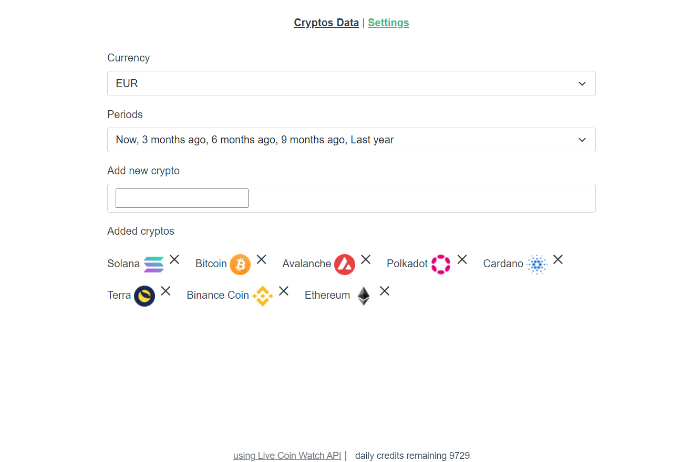
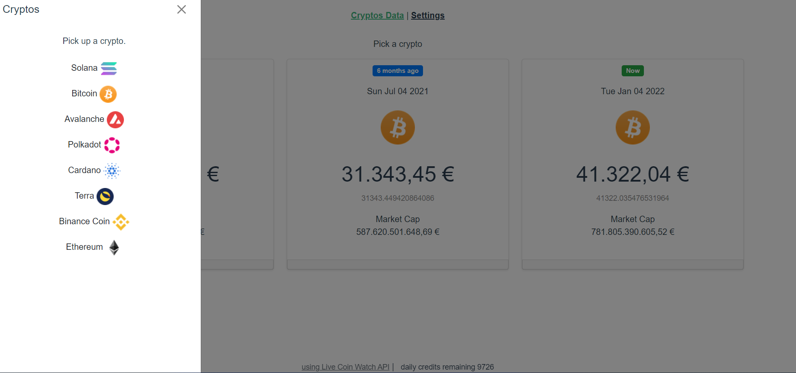
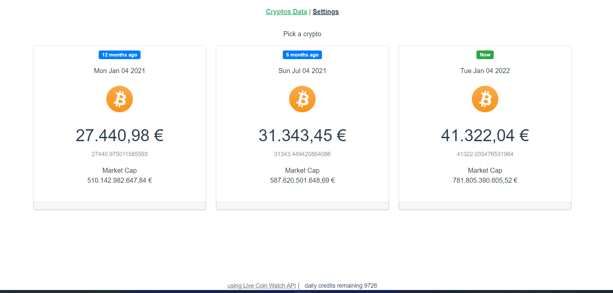
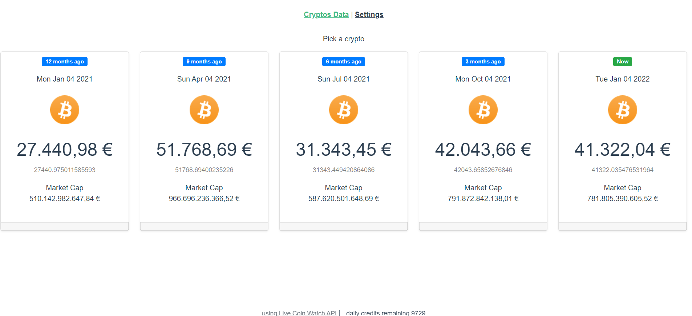
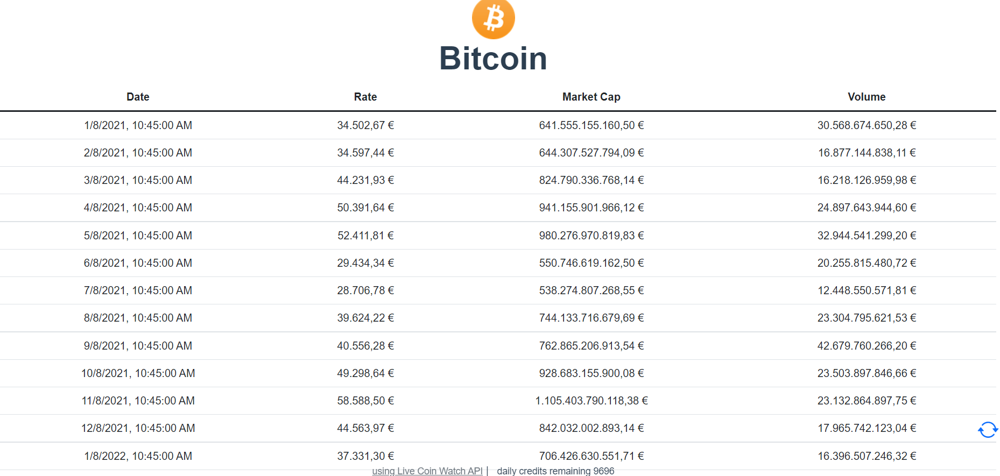

# A Simple Crypto Time Machine
See how your favorite cryptocurrency performed over the past year and six months compared to today. Three boxes provide essential information about the rate today vs. last year, today vs. six months ago, and the current rate. All you need is a Live Coin Watch API key.  
[https://www.livecoinwatch.com/tools/api](https://www.livecoinwatch.com/tools/api])  

# Run the project  
- create a file named **.env.local**  
- add a variable named   **VUE_APP_CRYPTO_API_KEY**
- initiliaze it with your Live Coin Api Key  

That's it, now you're ready to run the project.  
You'll find a short guide directly in the project.  
The aim of this project is to give an idea in the long term, comparing today to today but in different periods in the past.

# Project details
Developed with Vue 3  
[https://v3.vuejs.org/](https://v3.vuejs.org/)   

LiveCoinWatch Api Key  
[https://www.livecoinwatch.com/tools/api](https://www.livecoinwatch.com/tools/api])

## Quick guide
Setting the project  
  

Pick a crypto from your favourites list
 

How is going in three periods
  

How is going in five periods  
  

How is going in one year period  
 

